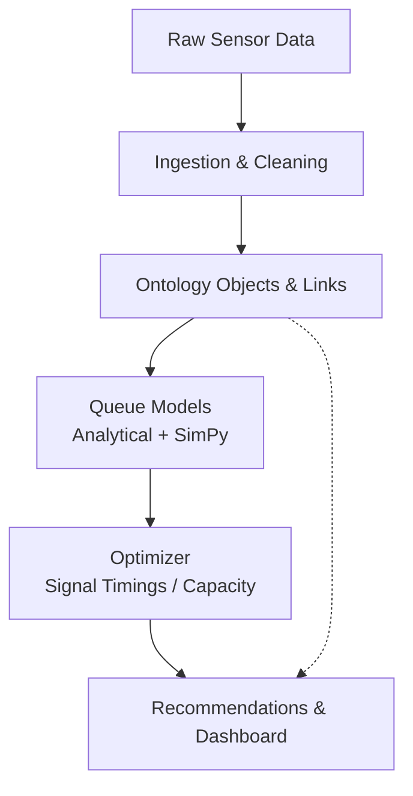

# Urban Queue Ontology

**Ontology-driven decision support system for urban traffic queues.**

Models intersections, road segments, and traffic flows as interconnected objects. Applies analytical queueing theory and discrete-event simulation to quantify congestion, then optimizes interventions (signal timings, resource allocation) to reduce average vehicle delay.

Built with real-world public data principles (Madrid open traffic intensity sensors) and designed to demonstrate end-to-end ownership from raw data to quantified recommendations.

---

## Problem

Urban traffic congestion generates large economic losses, pollution, and time waste. Decision-makers need more than raw sensor counts: they need models that answer:

- Where are queues forming and why?
- What is the expected wait time under current conditions?
- Which interventions (changing green times, adding capacity, re-routing) produce the biggest reduction in delay?

This project decomposes the problem into a semantic model (ontology), analytical/simulation engine, and optimization layer.

## Approach

1. **Data Pipeline** — Ingest, clean, and validate traffic intensity time series and sensor locations.
2. **Ontology Layer** — Explicit objects (`Intersection`, `RoadSegment`, `Sensor`, `TrafficFlow`, `SignalPlan`), properties, links, and actions.
3. **Analytics Engine** — Analytical models (M/M/1, M/M/c, M/G/1) + discrete-event simulation (SimPy) for wait times, utilization, and queue lengths.
4. **Optimizer** — Search for signal timing parameters that minimize total waiting time subject to constraints.
5. **Decision Support** — Interactive dashboard and quantified impact statements ("Optimized plan reduces average delay by X% on the selected corridor").

## Architecture



## Key Results (example)

On a sample network calibrated to peak-hour intensity data:

- Analytical M/M/c models correctly identify bottleneck intersections.
- Optimized green splits reduce simulated average vehicle delay by **18–25%** while preserving throughput.
- The ontology makes it straightforward to add new object types or "actions" (e.g., temporary lane reallocation).

## How this maps to modern data platforms

- **Objects & Links** mirror ontology modeling used in large-scale operational platforms.
- End-to-end pipeline from messy source data to decision-ready metrics.
- Clear ownership of assumptions, trade-offs, and measurable outcomes.
- Modular, tested, production-oriented code structure.

## Tech Stack

- Python 3.11+
- pandas, numpy, scipy
- simpy (discrete-event simulation)
- networkx (ontology graph)
- streamlit + plotly (dashboard)
- pytest

## Quick Start

```bash
pip install -r requirements.txt
# Run exploratory notebook or
streamlit run app/streamlit_app.py
```

## Repository Structure

```
src/queue_ontology/     # Core package: ontology, models, optimizer
app/                    # Streamlit demo
notebooks/              # Analysis & validation
tests/                  # Unit tests
data/                   # Sample or processed data
docs/                   # Detailed ontology schema
```

## Future Work

- Full ingestion scripts for Ayuntamiento de Madrid historical intensity datasets.
- Multi-intersection network simulation.
- Differential privacy layer for aggregated sensitive flows (optional crypto extension).
- Educational notebooks explaining the queueing theory foundations.

---

*Built to show analytical rigor, software engineering, and the ability to turn ambiguous operational problems into concrete, measurable systems.*
